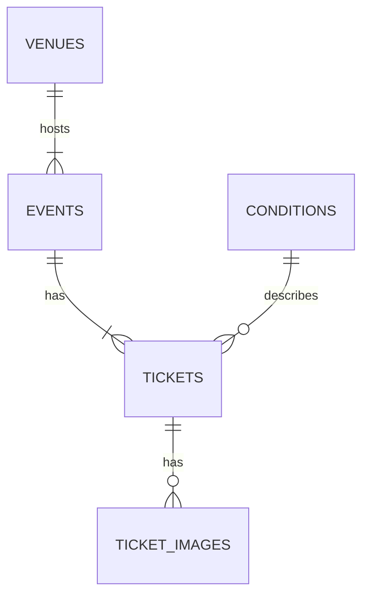

# Learning to code a new language with an AI tutor

I've been writing code in many different flavours for over 20 years. Everything from VBA, to Java, to Haskell. I wanted to get back into using a functional language, and [Clojure](https://clojure.org/) had instant appeal. I already owned [a book](https://www.braveclojure.com/) but after reading the first chapter, I thought I'd try something different: can AI actually *teach* me, rather than just doing the work for me? No [Vibe Coding](https://en.wikipedia.org/wiki/Vibe_coding), no 'just tell me the answer', just a tutor to help me learn, the way *I want* to learn.

This post covers how I set up [Claude Code](https://claude.com/claude-code) as my tutor, what worked, what didn't, and my recommendations if you want to try something similar.

## The app 👨‍💻

I have a large collection of event tickets (concerts, sports events etc.) and I wanted to build a 3-tier web app as an inventory of them. The app would have a SQLite database, and use [Clojure](https://clojure.org/) for the API & front-end.

## I defined the instructions & design first 📐

Before a single line of [Clojure](https://clojure.org/) was written, I defined three things:

1. A set of instructions for the AI, which I saved in a `CLAUDE.md` file.
   1. I used [ChatGPT](https://chat.openai.com/) to help ensure my instructions were clear, unambiguous and specified the basics for coding with Clojure.
2. I created the data model for the application I wanted to build, and wrote it down in a `data_model.md` file.
3. I also created an OpenAPI spec for the endpoints of the APIs I knew my application would need, which I saved in `openapi.yaml`.

As you can see, this wasn't about just getting AI to do it for me. I devised the exact plan for the application I wanted to build, and I wanted the AI to help me learn how to implement it in Clojure. I defined how the application was to be structured and designed, leaving [Claude Code](https://claude.com/claude-code) to simply help me implement it using Clojure, and to explain the concepts I needed to understand along the way.

### The instructions

A `CLAUDE.md` file, which [Claude Code](https://claude.com/claude-code) reads at the start of every session. It sets out:

* What it is I'm wanting to do
* The tech stack
* The project structure
* Most importantly, how I wanted to work/learn

Below is a snippet of the instructions, which I wrote before a single line of [Clojure](https://clojure.org/) was written.

```markdown
## Core Principles

### Test-Driven Development (TDD)

- **Always write tests first** before implementation
- Red → Green → Refactor cycle for every feature
- No code lands without corresponding tests

### Learning Through Building

- Explain Clojure concepts when introducing them
- Developer must write code, not just have Claude write it all.
  Consider when 'try and verify' should be used for new concepts
  and to cement learning.
- Include all explanations, lessons etc. in `/docs/training.md`
  so I can refer back to them later
```

There were three rules everything else relied on:

1. We write the tests first ([TDD](../articles/how-i-practice-tdd)).
2. I write the code.
3. Every lesson & question gets written down.

> 💡**Tip:** You can [download my full instructions here](/assets/articles/learning-to-code-with-ai/learning-to-code-in-clojure-instructions.zip).

### The data model

How I wanted the [SQLite](https://sqlite.org/) database to be structured, and how the tables related to each other.

```markdown
### Events

- id [auto] (Primary Key)
- name [string(150)]
- date [date] (Optional)
- unknownDate [boolean] (if date is unknown, default False)
- notes [string(1000)] (Optional)
- venueId [integer] (Foreign Key to `venue.id`)
```

Plus how they relate:



[](/assets/articles/learning-to-code-with-ai/entity-relationship-diagram.png)

From that, I also wrote an OpenAPI spec for the endpoints. None of it is complicated, for an experienced developer, but it meant I used the AI solely for learning, and I was still in control of the development process & structure.

## Filling in the gaps 🧩

The approach I valued most is what I've been calling 'fill in the gaps'.

Rather than handing me a finished method, Claude would explain the concept, then give me a skeleton with some parts left blank. My task was then to fill in the blanks. If I got stuck, I would ask Claude for help. Everything I asked was logged in the `docs/training.md` file so I could refer back to it later.

[](/assets/articles/learning-to-code-with-ai/learning-to-code-with-ai.png)

Why does this work so well? This is the difference between reading an example and completing an exercise yourself. To fill in the blanks, I had to read and understand the code around it. Copying blocks of finished code teaches you very little; filling the gap makes you think (hard at times). This wasn't just copy and paste (I tried to avoid CTRL+C, CTRL+V as much as possible, and instead would type what I saw).

> 💡**Tip:** You don't need a special tool or instructions for this. Just ask: *"Don't write it for me. Give me a skeleton with blanks and explain what goes in each."*

## Sometimes AI just did it anyway 🙈

It didn't always go to plan. Early on, while creating some of the database layer, Claude wrote the SQL file, the code that loads it and the tests, all without my input. Its reasoning was that it was 'just boilerplate'.

My response:

> you have just created code without me. You're meant to be teaching me.

Claude acknowledged the mistake and saved the correction to its memory so it would apply in future sessions. From then on Claude largely stuck to the plan.

The lesson for me was that AI **defaults to doing the work for you**, even when you've written down that you don't want it to. You have to keep on top of it and notice when AI isn't behaving as expected.

I did make exceptions, however: wiring up a logging library wasn't something I wanted to learn that day, so I let Claude do it. I was OK with this as I made that decision and I was still achieving my goal of learning Clojure.

## What I learned 📚

### The training log is gold

Every explanation went into `docs/training.md`, which is now over 800 lines of notes written about *my* code, questions & mistakes. For example (as taken from the training log, generated by Claude):

#### Testing server-rendered HTML with `hickory` instead of substrings

```markdown
## 2026-07-30 — Testing server-rendered HTML with `hickory` instead of substrings

The first version of `get-venues-renders-page` asserted on raw markup with
`str/includes?` and a regex counting `<li` occurrences. That style of
assertion has a real blind spot: it can't tell *where* text landed. This
came up for real — an earlier bug had venue names rendered as HTML
*attributes* instead of visible text (`<li id="1" venue="Anfield">`, empty
tag body), and the substring-based test still passed, because `<li` still
appeared twice in the markup. The test was checking the shape of the soup,
not what a browser would actually show a user.
```

### Being able to ask 'why' is really important

The most valuable exchanges weren't 'how do I do X?'. Early on, a test called `venue/create-venue!`, yet there was no `defn` for it anywhere. I didn't understand where it came from. It turns out HugSQL reads a comment in the SQL file (`-- :name create-venue! :<! :1`) and creates the function when this line loads:

```clojure
(hugsql/def-db-fns "sql/venue.sql"
  {:adapter (next-adapter/hugsql-adapter-next-jdbc)})
```

I also asked whether the `:venue` parameter was safe from SQL injection. Claude opened HugSQL's source and showed me the one function that swaps `:venue` for a `?` placeholder. Claude didn't just tell me the answer, it showed me.

### TDD worked well

In my [TDD post](../articles/how-i-practice-tdd) I said that I struggle to practise 'full' TDD in languages I don't know well. With an AI tutor on hand to explain the test framework, it was much easier. I stayed test-first throughout.

### It was (fairly) quick, and I understand it

In two days I had two working API endpoints and a working UI, with validation (for a single page), centralised error handling and styling, all test-first. More importantly, I could understand and explain the code, because I wrote it.

## What didn't work so well 🚧

### It was confidently wrong (sometimes)

* Claude added a dependency, `metosin/reitit-muuntaja`, that simply doesn't exist (the right one was `reitit-middleware`).
* The logging config it wrote had a `--` inside an XML comment, which isn't allowed, and crashed every test run before any Clojure loaded.
* The assertion pattern initially suggested by Claude in some of the unit tests was poor: it was asserting against substrings of the raw HTML rather than what would be rendered. It was only through my own experience and knowledge that I could see it could be give false positives, and needed improvement.

### Green tests, broken page

We had passing tests, yet the page didn't render. My validation errors returned the right HTML and status code, and every test passed. Yet nothing appeared on screen: htmx quietly discards error responses unless you tell it otherwise. My tests never ran a browser, so they couldn't see it. I only found it by manually testing. Claude didn't spot this (and we've not yet implemented proper browser testing).

### Its memory went stale

Claude keeps notes between sessions, but they aren't always current. When I came back after a break and asked 'where did we get to?', its notes said nothing had been committed since the first day; yet there had been a dozen commits since then. It corrected itself by checking git, but only because I asked. Trust but verify: don't assume the AI's memory is correct.

## Recommendations ✅

If you want to learn a new language with an AI tutor, I recommend:

1. **Own the design.** Write the instructions and the application design yourself, before any code. It keeps you in charge and enables the AI to be the tutor of what you want to learn.
2. **Ask for gaps, not answers.** Ask for skeletons with blanks, and write that into the instructions.
3. **Make it write everything down.** Log every explanation to a file.
4. **Keep TDD.** Writing the tests was a great introduction to the language and syntax, with fast feedback: you don't need to have a working app to know if your syntax is correct etc., simply run the test.
5. **Stay on your toes and trust your experience.** When the AI oversteps, is mistaken, or suggests something that doesn't pass the sniff test, tell it.
6. **Decide what it may write.** Boilerplate, config and dependency wiring probably isn't the goal of your learning, so let the AI handle it (but record that it did).

## Conclusion

I was frankly astonished at how well [Claude Code](https://claude.com/claude-code) worked as a tutor, though it needed my experienced eye to keep it on track, and **it will do the work for you if you let it**. Set the rules first, design the thing yourself and have the AI be your guide. Can I say I now 'know' [Clojure](https://clojure.org/)? Not really, but I'm definitely more knowledgeable. Let's see where I am when I've completed the build.

Next time you reach for an AI assistant to build something, because you don't know how to, try asking it *not* to write the code. You may be surprised how much more enjoyable & rewarding that is.
